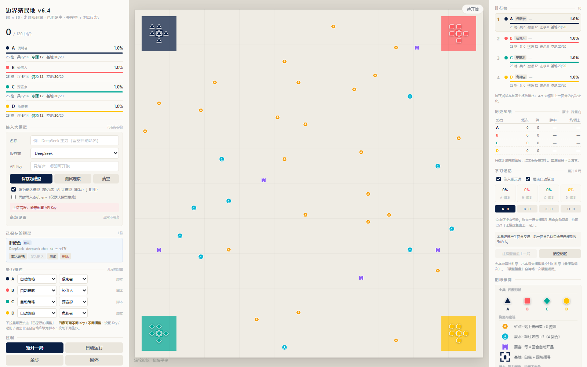

# 边界殖民地 · Border Colony

> **v6.4.0** — 50 × 50 回合制四势力领土争夺游戏。四家可由本地脚本、AI 大模型或两者混合操控，支持多份模型 Key 分别绑定势力，并带跨局对局记忆闭环。
>
> 后端 Node.js ESM（Express + Socket.IO），前端原生 Canvas，无构建步骤、无 LLM SDK 依赖。



---

## 目录

- [快速开始](#快速开始)
- [项目结构](#项目结构)
- [架构与数据流](#架构与数据流)
- [玩法规则](#玩法规则)
- [可调参数](#可调参数)
- [接入 AI 大模型](#接入-ai-大模型)
- [对局记忆](#对局记忆)
- [HTTP 接口](#http-接口)
- [环境变量](#环境变量)
- [测试](#测试)
- [数据与隐私](#数据与隐私)
- [常见问题](#常见问题)
- [版本记录](#版本记录)

---

## 快速开始

```bash
cd border-colony
npm install
npm start
```

打开 **http://127.0.0.1:3000**。

环境：Node.js 18+（用到原生 `fetch`，开发与测试环境为 Node 22）。运行时依赖只有 `express`、`socket.io`、`dotenv` 三个。

启动行为：**每次启动都会强制开一局 T0 / 120 的初始棋盘**，固定 `seed=20261106`，因此泉水、矿点、基地布局每次完全一致；自动运行、上局结果、回合反馈与模型调用状态一并清空。想改见[环境变量](#环境变量)。

页面上：左栏「控制」区「自动运行」开始推演，「单步」走一回合，「暂停」停止；「玩法参数」可改 15 项规则数值，改完点「新开一局」生效。右栏看排行榜、历史战绩、学习记忆、图标示例、趋势图和本回合 Δ。

---

## 项目结构

```
border-colony/
├── server/                       后端（Node.js ESM，无框架之外的抽象层）
│   ├── index.js                  HTTP / WebSocket 入口、回合驱动、全部 API、启动开局
│   ├── engine.js                 纯规则裁判：地图、占领、包围、战斗、资源、胜负
│   ├── bots.js                   四种本地脚本策略 + 默认打法
│   ├── gameLoop.js               提示词构建、模型动作清洗、CLI 自动对局入口
│   ├── llm.js                    零 SDK 模型请求层（OpenAI 兼容 / Anthropic）+ 端点安全校验
│   ├── profiles.js               多模型配置库：CRUD、默认模型、脱敏视图
│   ├── controllers.js            势力操控模式归一化（脚本 / 大模型 / 指定模型）
│   ├── memory.js                 三层对局记忆、复盘提炼、战绩统计与持久化
│   └── jsonStore.js              JSON 原子写入与损坏备份
├── public/
│   ├── index.html                页面骨架与全部样式（左栏 / 棋盘 / 右栏）
│   └── app.js                    Canvas 渲染、Socket 状态同步、全部面板交互
├── test/
│   ├── rules.mjs                 规则单测（坐标、占领、包围、战斗、参数边界）
│   ├── llm.mjs                   模型接入层单测（协议、脱敏、端点校验、JSON 清洗）
│   ├── memory.mjs                记忆纯函数与落盘单测
│   ├── balance.mjs               多局自动对局平衡回归 + 同 seed 复现断言
│   └── llm-integration.mjs       端到端：本地 mock 模型端点，不访问外网
├── docs/
│   └── AI-PROTOCOL.md            AI 玩家通信协议（节点 N0–N4、HTTP 接口、记忆闭环）
├── data/                         运行时生成，已被 .gitignore 忽略
│   ├── llm-profiles.json          已保存的模型配置（含明文 Key，注意保密）
│   └── llm-memory.json            跨局战绩与复盘经验（跑完一局后生成）
├── .env                          本机私有配置，已被 .gitignore 忽略
├── .env.example                  环境变量说明模板
├── .gitignore
├── package.json / package-lock.json
└── preview.png                   界面截图
```

### 模块规模与职责（整理时）

| 文件 | 行数 | 职责边界 |
|---:|---:|---|
| `public/app.js` | 1430 | 前端唯一脚本：领土位图渲染、图标绘制、图例/趋势图、左右栏 DOM 更新 |
| `server/engine.js` | 927 | **唯一规则来源**，无 IO；`createGame / resolveTurn / getViewFor / encodeTerritory` |
| `server/index.js` | 778 | 把引擎、脚本、模型、记忆串成回合；对外 API 与 `state` 广播 |
| `server/memory.js` | 546 | `summarizeMatch / deriveLessons / buildRecall / buildFeedback` + `MatchMemory` |
| `public/index.html` | 429 | 单页骨架 + 内联 CSS，无外部样式表 |
| `server/bots.js` | 420 | `aggressive / economist / fortress / turtle` 四套 `buildActions` |
| `test/llm-integration.mjs` | 394 | 起本地 mock 端点与隔离端口，验证整条链路 |
| `test/llm.mjs` | 363 | 模型层单测 |
| `test/rules.mjs` | 338 | 规则回归基线 |
| `test/memory.mjs` | 305 | 记忆层单测 |
| `server/llm.js` | 235 | `PROVIDERS / resolveConfig / askLLM / testLLM / assertSafeBaseURL` |
| `server/gameLoop.js` | 232 | `buildPrompt(view, strat, recall)`、`sanitizeActions`、CLI `--auto` |
| `server/profiles.js` | 178 | `ProfileVault`，最多 16 份模型 |
| `test/balance.mjs` | 94 | 12 局健全性 + 复现断言 |
| `server/controllers.js` | 75 | 纯函数，前后端共用同一套操控 key |
| `server/jsonStore.js` | 44 | `writeJsonAtomic / readJsonSafe` |
| `docs/AI-PROTOCOL.md` | 449 | 协议文档（含第 8 节 HTTP 接口、第 9 节记忆闭环） |

---

## 架构与数据流

```
  浏览器 public/app.js
    │  HTTP POST：/api/new · /api/step · /api/auto · ...
    ▼
  ┌──────────────────────── server/index.js ──────────────────────────┐
  │  tick() ──┬─► engine.resolveTurn() ─► 新局面 ─► publicSnapshot() ──┼──► WebSocket `state` 广播回浏览器
  │           │                                                        │
  │           ├─ 脚本势力 ─► bots.buildActions(view)                    │
  │           │                                                        │
  │           └─ 模型势力 ─► gameLoop.buildPrompt(view, strat, recall)  │
  │                            └─► llm.askLLM() ──────────────────────┼──► 外部模型 API
  │                                   ▲                                 │
  │       memory.buildRecall() ──────┘                                  │
  │                                                                    │
  │  memory.MatchMemory    ─► data/llm-memory.json                      │
  │  profiles.ProfileVault ─► data/llm-profiles.json                    │
  └────────────────────────────────────────────────────────────────────┘
```

- **规则只有一份**：`engine.js` 是裁判，前端只负责画；动作来自脚本或模型，都必须过 `sanitizeActions` 和裁判校验。
- **坐标 1-based**：`(x, y)` 从 1 到 50，数组下标 `(y-1)*50+(x-1)`；渲染时用 `(x-0.5)*cell`。
- **确定性**：地图与随机事件用注入种子的 RNG，同 seed + 同参数 + 同操控配置可完全复现。
- **领土传输**：服务端用 1 格 = 1 像素的离屏 `ImageData` 编码成字符串，前端一次绘制整张位图，而不是逐格 `fillRect`。
- **降级不卡局**：四家模型请求同回合并发，某一家超时 / 无 Key / 输出非法，只让该家本回合改用脚本。

---

## 玩法规则

| 机制 | 规则 |
|---|---|
| 占领 | 士兵**走过的每一格 + 周边 8 格**重新归己方，敌方领土也照翻（走过即翻旗）；驻足士兵每回合开垦脚下 3×3 |
| 包围 | 中立格四个正交邻格同属一家 → 归该家；己方连通块被单一敌家从 8 向完全围住、且块内无己方士兵 → 整块易主。基于同一快照判定，不连锁；地图边界不算墙 |
| **障碍** | 地图上有随机**连续成片**的深灰格（默认占 8%，**硬上限 10%**）：**不可通行、不可占领、不可布置资源**。`territoryMap` 里记作 `#`；path 里出现 `#` 会被整条判为非法丢弃。生成时避开四家基地周边与中央，并保证四家都能走到中央；同 seed 生成同一张地图 |
| 士兵 | **血量固定 10 点**，走到哪都一样（不再随离基地距离衰减）；踩过泉水格获得 +3 攻击，持续 4 回合；士兵可阵亡 |
| 交战 | **距离 ≤ 2 格（切比雪夫，含斜向）即自动交战**：双方每回合互相开火一次，伤害固定 = 攻击力，不需要下攻击指令。`attack` 只用来指定优先目标（集中火力），不指定就打最近的敌人；`defend` 的单位本回合不开火、但受伤减半 |
| 群殴 | 同一个目标本回合被 N 个敌对士兵同时攻击时，每个攻击者伤害 **+（N−1）**，最多 **+3**；被 **≥2 人**围攻时，它的 `defend` 减伤失效（破防）；要塞的地形减伤 −1 仍然生效 |
| 资源 | 普通矿点靠士兵站上去 `harvest` 采集（+3，储量有限会枯竭）；**中央黄金矿**见下条；资源用于生产新兵（每回合最多 1 个），有士兵上限 |
| **黄金矿** | 固定在正中央 **(25,25)**，占 1 格，**资源总量无限、永不枯竭、不会被摧毁**。任意一家士兵站上去即占领，之后**每回合自动 +2 资源**（`goldYield` 可调），不需要留兵驻守；别家把兵踩上去就立刻易主，持有方亡国则矿归无主。它不属于任何人，也不算障碍 |
| 要塞 | 占领后**每 4 回合**向周边扩张，且只吃中立格 |
| 基地 | 敌方单位站上基地格即削减耐久；耐久归零 → 该势力亡国，全部领土归攻陷方 |
| 胜负 | 只剩一家有基地 → 征服胜，立即结束；回合耗尽 → 领土最多者胜，同分依次比单位数、采集量、击杀数 |
| 外交 | **没有结盟**，四家永远敌对 |

四家颜色：A 深海军蓝 `#0A1F44`、B 珊瑚红 `#FF5A5F`、C 青绿 `#00A896`、D 金黄 `#FFC300`，单位用不同形状区分。

---

## 可调参数

左栏「玩法参数」共 15 项，超出范围自动夹到边界；改完需点「新开一局」。默认值与上下限定义在 `server/engine.js` 的 `CFG_DEF` / `CFG_LIMITS`，前后端共用。

| 参数 | 默认 | 范围 | 参数 | 默认 | 范围 |
|---|---:|---|---|---:|---|
| `turns` 回合数 | 120 | 10–2000 | `unitCost` 生产消耗 | 12 | 4–40 |
| `unitsPerAI` 初始士兵 | 6 | 2–16 | `mines` 矿点数 | 24 | 6–60 |
| `maxUnits` 士兵上限 | 14 | 4–40 | `springs` 泉水量 | 10 | 0–30 |
| `unitHp` 士兵血量 | 10 | 4–40 | `fortresses` 要塞数 | 5 | 0–12 |
| `hpDecay` 血量衰减 %/格（固定血量下不生效） | 1.5 | 0–8 | `baseHp` 基地耐久 | 20 | 10–100 |
| `attack` 初始攻击力 | 3 | 1–10 | `siege` 围攻伤害 | 12 | 2–30 |
| `moveRange` 移动力 | 3 | 1–8 | `wallRatio` 障碍占比 % | 8 | 0–10 |
| `goldYield` 黄金矿每回合产出 | 2 | 0–8 | | | |

`RULES` 里的法则不开放调节：占领半径 1、每回合产兵 1、初始资源 12、单次采集 3、矿点储量 5、泉水加成 3 攻 / 4 回合、基地 2 格内回血 2、**障碍占比硬上限 10%**、基地周边 4 格与中央 3 格为障碍保护区。**视野目前为全局**（`RULES.globalVision = true`）：四个阵营都能看到全场敌方单位、资源点与障碍，没有战争迷雾；改成 `false` 则退回「每个士兵 4 格半径」的局部视野。

---

## 接入 AI 大模型

**最小用法**：左栏「接入大模型」→ 选服务商 → 粘 API Key → 点「保存为模型」。端点、模型名、温度、超时都有预设，不用填。

- 内置 7 个预设：`openai` / `deepseek` / `qwen` / `zhipu` / `moonshot` / `anthropic` / `custom`。除 `anthropic` 走原生 `/messages` 外，其余（含需手填端点的 `custom`）都走 OpenAI 兼容 `/chat/completions`；全部用 Node 原生 `fetch`，不装任何 SDK。
- **可保存多份模型**（最多 16 份），每份有名称、服务商、Key、端点、模型名与采样参数。列表支持载入编辑、设为默认、单独测试、删除。
- 「势力操控」四行下拉可选 `自动策略`、`AI 大模型（默认）`、或**任意一份已保存的模型**。A 用 DeepSeek、B 用 GPT 这类混合配置是支持的，同回合并发请求、互不串号（`strictKey` 保证不会回落到 `.env` 里的别的 Key）。
- 打法风格 `auto / aggressive / economist / fortress / turtle`：脚本模式下是真正执行的策略；大模型模式下是提示词人格。
- 每次请求的提示词结构：角色与打法 → **「最高指令 · 全力求胜」8 条准则**（算胜势、拒绝空转但经济优先、资源当弹药、进攻算收益且避免孤军、领先扩大 / 落后冒险、锁定第二名重点打、算代价换血、不放弃）→ **信息对称说明** → 局面 JSON（含逐格地图）→ 历史记忆 → 输出格式 → 规则 → 胜负结算与输出前自检。求胜段只加约束、不改动作语法，输出仍是原来的单个 JSON。
- **信息对称**：`getViewFor` 下发的 `territoryMap` 是整张 50×50 逐格归属，与脚本策略通过 `territoryAt(game,x,y)` 读到的是同一份网格；`standings` 含四家库存 / 击杀 / 采集，`visibleEnemies` 含敌方单位的血量 / 攻击 / 泉水状态。局部视野模式下地图按 `seen(x,y)` 遮蔽视野外格。
- **地形与黄金矿对四家公开**：`territoryMap` 里 `#` 是障碍（不可通行 / 不可占领），`goldMine` 给出中央矿的坐标、当前持有者、每回合产量与累计产出，`wallCount` 是障碍格数。四家拿到的完全相同。
- **裁判不偏袒**：四家共用一套校验，`move.path` 首格必须与士兵当前坐标相邻、逐格连续、全部在界内、**不得踩 `#` 障碍格**；不合法动作**整条丢弃、不自动纠偏**。`lastRejected` 把上一回合四家被丢弃（`invalid`）/ 被占位阻挡（`blocked`）的动作数对称公开，模型要自己改，服务端不代劳。
- 默认脚本对手（A 侵略者 / B 经济人 / C 要塞家 / D 龟缩者）不做任何削弱；想做同模型对比，在「势力操控」里让四家都接模型即可。
- 缺 Key、超时、401、返回非 JSON → **该势力本回合自动降级为脚本**，左侧与排行榜会显示状态和所用模型名。

> 想直接给大模型写玩家程序？完整通信契约（回合节点 N0–N4、视野 JSON、动作语法、结算顺序）见 [`docs/AI-PROTOCOL.md`](docs/AI-PROTOCOL.md)。

---

## 对局记忆

LLM 每次请求都是无状态的，所以「让模型从过往对局里学」由服务端实现，把三层反馈回灌进 `buildPrompt(view, strat, recall)`：

| 尺度 | 内容 |
|---|---|
| 局内 | 上回合做了什么，以及领土 / 士兵 / 资源 / 击杀的 Δ 与阵亡事件 |
| 跨局 | 累计场次、胜率、大模型操控胜率、平均名次、最近 3 局、常见败因 |
| 经验 | 局末复盘提炼的可执行建议，注入前 3 条，限长 1200 字符 |

- 右栏「学习记忆」：`注入提示词` 开关、`局末自动复盘` 开关（规则化复盘，不调模型、不花钱）、四家页签、经验条目增删、手动「让模型复盘上一局」（消耗一次模型调用）、清空记忆。
- 经验会记录「被注入几次 / 之后赢几局」，按净胜场排序；无效的可直接删，避免越学越差。
- 战绩与经验**跨重启保留**；脚本势力打的局只进战绩，不生成经验。
- 验证胜率是否真提高的做法：同 seed、同对手配置，关 / 开「注入提示词」各跑 10–20 局，比 `stats[ai].llmWinRate`。这是上下文学习，不改模型权重。

---

## 大模型思维日志

每次模型调用都会把**思维过程 + 原始输出 + 清洗后动作 + 上回合被拒数**同步落到 `logs/llm-YYYY-MM-DD.log`（`server/logger.js`，`appendFileSync` 即时写，写失败也绝不影响对局），同时在控制台镜像一行。

```
[2026-11-06 23:11:02] T012 A custom/mock-reasoner 23ms ok
  lastRejected: {"invalid":2,"blocked":0}
  note: 先抢泉水
  thinking: 对手 B 的 3 号兵在左翼，我先把 1 号兵压到泉水，喝到加攻后再合围。
  raw: {"note":"先抢泉水","actions":[{"unit":"A01","type":"move","path":[[5,5]]}]}
  actions: [{"unit":"A01","type":"move","path":[[5,5]]}]
```

- `raw` 是**模型原文**（清洗前），`actions` 是**实际提交给裁判**的动作；两者对照就能查出"模型下了但被丢掉"的动作。
- `lastRejected` 是上一回合该势力被裁判丢弃（`invalid`）或一步没走成（`blocked`）的动作数，四家口径一致。
- **思维过程**取 `reasoning_content`（DeepSeek-R1 / Qwen / GLM 等推理模型）或 Anthropic 的 `thinking` 块；`gpt-4o` 这类不暴露推理的模型这一行就是空的，只能记录动作。
- 失败也会记录：`parse`（输出不是合法 JSON，已降级脚本）、`error`、`nokey`。
- 单条 `thinking` 上限 8000 字、`raw` 上限 4000 字、`actions` 上限 1200 字，超出截断并标注原文字数。
- 不开文件也能看：`GET /api/llm/log?limit=400` 返回当天日志末尾若干行。
- 日志目录可用 `LOG_DIR` 改到别处；`logs/` 默认在 `.gitignore` 里。

---

## HTTP 接口

所有接口返回 JSON，**任何响应都不含明文 API Key**（只给 `keyMask`）。有对局时，Socket.IO 连接后推送 `state` 事件，内容与 `GET /api/state` 的 `game` 一致。

### 配置与状态

| 方法 | 路径 | 说明 |
|---|---|---|
| GET | `/api/config` | 地图尺寸、参数默认值 / 上下限 / 标签、策略、风格、服务商、已保存模型、当前操控 |
| GET | `/api/state` | 当前完整快照（见下） |
| GET | `/api/llm/config` | 默认模型状态：`hasKey / keyMask / provider / model / perAI / profiles / lastError` |
| GET | `/api/llm/log` | 当天大模型思维日志末尾若干行：`?limit=400`（20–2000），返回 `{file, lines}` |
| POST | `/api/llm/config` | 写默认配置；不传 `apiKey` 表示保留原 Key，`persist:true` 写回 `.env` |
| POST | `/api/llm/test` | 测试连通性，返回 `{ok, ms, preview}` |
| POST | `/api/llm/clear` | 清除默认模型内存与 `.env` 中的 Key |
| POST | `/api/llm/profiles` | 保存 / 编辑一份命名模型 |
| POST | `/api/llm/profiles/test` | 测某一份已保存模型 |
| POST | `/api/llm/profiles/default` | 设为默认模型 |
| POST | `/api/llm/profiles/delete` | 删除模型；被引用的势力自动退回默认模型 |

### 操控与记忆

| 方法 | 路径 | 说明 |
|---|---|---|
| GET / POST | `/api/controllers` | 读写四家操控：`{controllers:{A:{mode,strategy,profileId?},…}}` |
| GET | `/api/memory` | 记忆视图：`enabled / reflectEnabled / matches / lessons / stats / totalMatches` |
| POST | `/api/memory/config` | 开关设置 `{enabled?, reflectEnabled?, maxLessons?}` |
| POST | `/api/memory/clear` | 清空战绩与经验（保留开关） |
| POST | `/api/memory/lesson` | 手记经验 `{ai,text}` 或删除 `{action:'remove',ai,id}` |
| POST | `/api/memory/reflect` | 让模型复盘上一局 `{ai?,profileId?}`，产出 1–3 条经验 |

### 对局

| 方法 | 路径 | 说明 |
|---|---|---|
| POST | `/api/new` | 开新局 `{seed?,turns?,cfg?,controllers?}` |
| POST | `/api/step` | 单步推进一回合 |
| POST | `/api/auto` | 开新局并自动运行 `{interval?,seed?,cfg?,controllers?}` |
| POST | `/api/stop` | 暂停自动运行 |
| POST | `/api/llm-game` | 兼容旧接口：四家全切默认大模型并自动开跑 |

快照主要字段：`turn / maxTurns / over / winner / winType / events / cfg / assignment / controllers / leaderboard / records / memory / feedback / lastResult / llm / territoryCount / territory（编码位图）/ scores / kills / stock / alive / hasBase / bases / ranking / units / resources / history（最近 160 回合）`。

CLI 也能脱离网页跑纯脚本对局：

```bash
node server/gameLoop.js --auto --seed 20261106 --turns 120
node server/gameLoop.js --auto --strategies aggressive,economist,fortress,turtle --mines 30
```

---

## 环境变量

复制 `.env.example` 为 `.env` 后按需修改；左栏保存模型时勾选「同时写入本机 .env」，会按所选协议把 `OPENAI_*` 或 `ANTHROPIC_*` 三项写回 `.env`。

| 变量 | 默认 | 说明 |
|---|---|---|
| `PORT` | `3000` | 监听端口 |
| `HOST` | `127.0.0.1` | 默认只监听本机；服务无鉴权，需局域网访问才设 `0.0.0.0` |
| `TURN_DELAY_MS` | `0`（`.env.example` 示例为 `1200`） | 仅作用于 `server/gameLoop.js` 的 CLI 自动对局回合间隔；网页自动运行的速度由左栏「速度」或 `/api/auto` 的 `interval` 控制 |
| `AUTO_START` | 开启 | 设 `0` 则启动后不自动开局（空棋盘，需手动点「新开一局」） |
| `AUTO_START_SEED` | `20261106` | 启动初始布局的种子 |
| `OPENAI_BASE_URL` / `OPENAI_API_KEY` / `OPENAI_MODEL` | 见 `.env.example` | OpenAI 兼容端点的兜底配置 |
| `ANTHROPIC_BASE_URL` / `ANTHROPIC_API_KEY` / `ANTHROPIC_MODEL` | 同上 | Anthropic 原生端点 |
| `LLM_ALLOW_PRIVATE_ENDPOINTS` | `0` | 设 `1` 才允许自定义端点指向局域网 / 私网地址 |
| `LLM_PROFILES_FILE` | `data/llm-profiles.json` | 多模型配置落盘位置 |
| `LLM_MEMORY_FILE` | `data/llm-memory.json` | 记忆落盘位置 |
| `N` | `12` | `test/balance.mjs` 的跑局数 |

> `.env.example` 里的 `DEFAULT_TURNS` 目前**代码未读取**，回合数由 `cfg.turns`（左栏「玩法参数」或 `POST /api/new` 的 `cfg`）决定。

---

## 测试

```bash
npm test              # 一条命令跑完全部 6 组
```

| 命令 | 覆盖 |
|---|---|
| `npm run test:rules` | 规则边界：坐标、占领翻旗、包围易主、攻击距离、动作去重、亡国两阶段结算、参数归一化 |
| `npm run test:llm` | 两种协议、服务商预设、Key 脱敏、端点安全校验、401 / 超时、JSON 清洗、提示词 |
| `npm run test:memory` | 复盘提炼、召回、反馈、统计、原子落盘与损坏恢复 |
| `npm run test:balance` | 12 局平衡健全性 + 同 seed 复现断言 |
| `npm run test:bots` | CLI 纯脚本整局（同 seed 与 Web 一致） |
| `npm run test:llm-integration` | 端到端：本地 mock 一个 OpenAI 兼容端点，临时占用 `3398` / `3399`，不访问外网、不改动 `.env` |

集成测试会 spawn 一个隔离端口的服务实例，并把模型 / 记忆文件指向临时目录；测试之间不要并行跑（端口是固定的）。

---

## 数据与隐私

- `data/` 与 `.env` 都在 `.gitignore` 里，**不要提交**。`data/llm-profiles.json` 含明文 API Key。
- 两个 JSON 文件通过 `server/jsonStore.js` 以「临时文件 + `renameSync`」原子写入，创建时请求 `0600` 权限（Windows 上由目录 ACL 决定，请把 `data/` 留在仅本人可读的位置）；读取时发现文件损坏会先备份成 `.corrupt-<时间戳>` 并告警，不会静默清空。
- 服务端所有对外输出经 `publicProfile()` / `maskKey()` 脱敏；模型错误信息也不回显上游原始响应体。
- 端点安全：`assertSafeBaseURL()` 默认只允许 **https 公网**或 **http 本机**（Ollama / 本地 vLLM 可用），拒绝私网与云元数据地址。把端点改成新的自定义地址但不填 Key 时，已保存的 Key 与 `.env` 兜底 Key 都不会被带过去。
- 服务**没有任何鉴权**，默认只监听 `127.0.0.1`。设 `HOST=0.0.0.0` 前请自行加反向代理认证。

---

## 常见问题

| 现象 | 处理 |
|---|---|
| 页面棋盘空白、右栏显示「等待对局数据…」 | 服务没开或 `AUTO_START=0`。先 `npm start`，或点左下「新开一局」 |
| `EADDRINUSE: port 3000` | 已有实例在跑：用 `netstat -ano` 找出 3000 端口的 PID 后结束，或换 `PORT=3001 npm start` |
| 启动后不是 T0 | 检查是否设了 `AUTO_START=0`；正常启动每次都会重置回 T0 / 120 |
| 「换到别的端点测试连接」提示未配置 Key | 这是防 Key 外带的预期行为，测试时把该端点的 Key 一起贴上 |
| 局域网自建模型服务被拒 | 设 `LLM_ALLOW_PRIVATE_ENDPOINTS=1`，并确认 `HOST` 与端点协议符合要求 |
| 模型势力显示「已降级 / 输出异常」 | 看左栏状态文字与 `llm.lastError`；该回合已自动改跑脚本，对局不会卡住 |
| 想清空学习记录 | 右栏「清空记忆」，或直接删 `data/llm-memory.json`；删 `data/llm-profiles.json` 等于删掉所有已保存模型 |

---

## 版本记录

| 版本 | 主要变化 |
|---|---|
| v6.0 | 基于 v5 全量重构规则：走过翻旗、包围易主、距离衰减血量、泉水、13 项可调参数、四套测试策略 |
| v6.1 | 取消结盟、右侧信息栏（示例图标 / 每回合 Δ / 排行榜）、包围判定改为快照 BFS |
| v6.2 | 左栏接入大模型（零 SDK）、四势力可选模型或脚本、右栏排行榜与历史战绩 |
| v6.3 | 多模型配置库：命名保存多份 Key，势力下拉分别绑定，互串防护 |
| v6.4 | 对局记忆闭环：局内 Δ / 跨局战绩 / 复盘经验回灌提示词，战绩跨重启持久化 |
| v6.5 | 全局视野；交战改为距离 ≤2 自动互射；大模型思维过程写入 `logs/`；提示词加「全力求胜」指令 |
| v6.6 | 血量改为固定值（取消距离衰减）；新增群殴规则（多人同打一人加成 + 破 defend 减伤）；启动即 T0；P0 审查修复；`npm test` 聚合 |
| v6.7 | **信息与裁判对齐** —— 下发给大模型的逐格领土地图 / 敌方单位完整字段 / 四家统计与脚本等价；裁判严格校验 path 且不替任何一方纠偏，`lastRejected` 四家对称回灌；日志补记原始输出与被拒数；提示词修掉「全员开垦压过经济」的误导 |
| 当前 | v6.8：**地形与黄金矿** —— 随机连续深灰障碍（≤10%，不可通行 / 占领 / 布置资源，生成避让基地与中央并保证连通）；正中央无限黄金矿（站上即占领，每回合被动产出，可被易主）；新增 `wallRatio` / `goldYield` 两项可调参数；视图、提示词、前端图例与协议文档同步 |

协议与接口细节以 [`docs/AI-PROTOCOL.md`](docs/AI-PROTOCOL.md) 为准；规则细节以 `server/engine.js` 为准。
